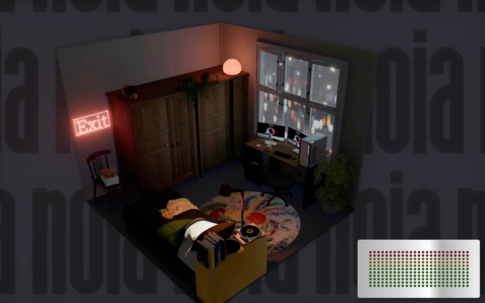
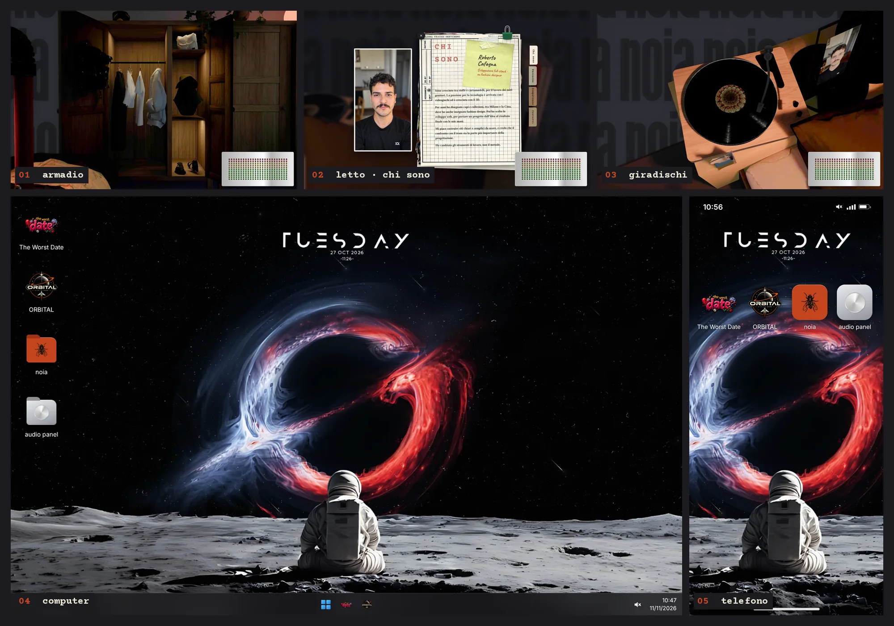
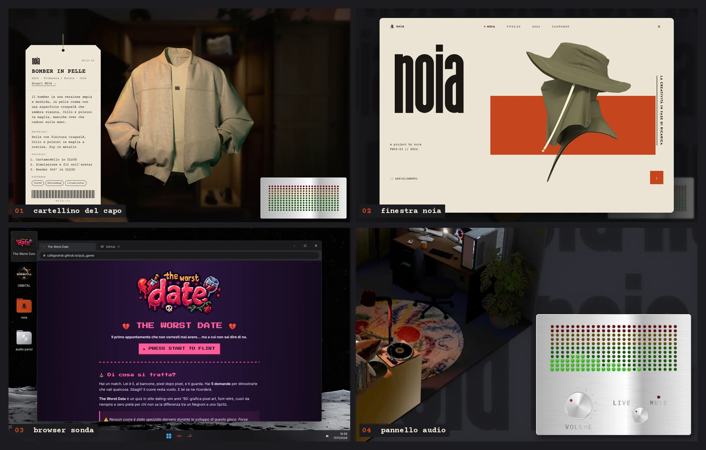

<div align="center">



# LA CAMERETTA

**Il mio portfolio è una stanza. Ogni oggetto racconta un pezzo del mio lavoro.**

`React Three Fiber` · `three.js` · `TypeScript` · `Redux Toolkit` · `Blender` · `CLO3D` · `Web Audio API`

[**Visita la stanza →**](https://LINK-DEL-SITO)

</div>

---

## In sintesi

| | |
|---|---|
| **Progetto** | Portfolio personale: una cameretta 3D isometrica da esplorare |
| **Ruolo** | Tutto: concept, modellazione e bake in Blender, capi in CLO3D, UI/UX in Figma, sviluppo front-end |
| **Strumenti** | Blender (Cycles), CLO3D, Figma, Photoshop · React 19, TypeScript, React Three Fiber, Redux Toolkit, CSS Modules, Vite |
| **Piattaforme** | Desktop e mobile, ogni componente pensato per entrambi |

> Vengo dalla moda: bozza, prototipo, revisione, capo finito. Ho cambiato gli strumenti di lavoro, non il metodo.

---

## L'idea

Un portfolio classico è una pagina che scorre. Io volevo un posto in cui **entrare**: una stanza in cui ogni oggetto apre un capitolo del mio percorso.

| Oggetto | Cosa racconta |
|---|---|
| **L'armadio** | I capi del mio brand **NOIA**: si prendono dalla gruccia, si girano a 360° e hanno un cartellino con collezione, materiali e processo |
| **Il computer** | I progetti di sviluppo: un desktop con le icone, un browser finto che digita l'indirizzo, i README dei progetti e i giochi giocabili |
| **Il telefono** | Gli stessi progetti in versione mobile, come le app di una home |
| **Il letto** | Chi sono: percorso, competenze, contatti |
| **Il giradischi** | La musica della stanza, con un pannello audio vero in basso a destra |



---

## Cosa c'è dentro

### La stanza
- **Modellata e illuminata in Blender**, con luce **baked** in Cycles: ombre e riflessi sono già nelle texture, quindi nel browser la scena è leggera ma sembra renderizzata.
- **Camera isometrica** che si muove di pochi gradi, senza mostrare cosa c'è dietro i muri, e vola verso l'oggetto cliccato.
- **Sfondo animato** con il logo NOIA che scorre lentamente, scritto come shader.
- **Schermi vivi**: monitor e telefono mostrano lo sfondo del desktop, applicato con UV calcolate sul piano dello schermo.

### L'armadio e NOIA
- **Turntable a 360°**: 32 fotogrammi renderizzati in CLO3D, trascinabili con mouse o dito, con zoom ad alta risoluzione caricato solo quando serve.
- **Il cartellino**: un'etichetta appesa disegnata in CSS, con codice, collezione, materiali, processo, software e un codice a barre decorativo.
- **La cartella NOIA**: una finestra in stile editoriale con manifesto, identità visiva, collezioni FW22-23 e SS24, campagne con foto e video e un visore a tutto schermo.

### Il computer e il telefono
- **Desktop credibile**: icone, barra delle applicazioni, menu Start con "Spegni" e animazione del vecchio monitor.
- **Browser "Sonda"**: digita l'indirizzo lettera per lettera, poi apre il sito, il README del progetto o la pagina GitHub.
- **README renderizzati** da GitHub in tempo reale, con temi diversi per progetto: pixel, terminale, radio.
- **Giochi giocabili** a tutto schermo: The Worst Date e ORBITAL.
- **La cartella Audio Panel**: il caso studio del pannello audio, impaginato come una presentazione di prodotto.

### Il suono
- **Pannello audio** in stile hardware vintage, progettato in Figma: manopola del volume, selettore LIVE/MUTE e spettro di LED che si accendono a ritmo.
- Il sito **parte in silenzio**: alzare il volume avvia il giradischi, cliccare il giradischi fa salire il volume da solo.



---

## Il processo

| Fase | Strumento | Risultato |
|---|---|---|
| 1. Concept | carta, Figma | pianta della stanza, oggetti e percorsi di navigazione |
| 2. Modellazione | Blender | la stanza low-poly, ogni oggetto con un nome che il codice riconosce |
| 3. Luce e bake | Blender Cycles | luce e ombre "cotte" nelle texture |
| 4. Capi | CLO3D | cartamodello, simulazione e render a 360° |
| 5. Interfacce | Figma | pannello audio, cartellino, finestre, design system |
| 6. Sviluppo | React Three Fiber | scena, interazioni, interfacce, audio |

---

## Dal design al codice

### Architettura

```text
React (interfacce HTML/CSS)            React Three Fiber (scena 3D)
        │                                       │
        └──────────── Redux Toolkit ────────────┘
                 cosa è aperto, cosa si guarda,
                 volume, musica, capo in ispezione
```

La scena 3D e le interfacce HTML vivono in due mondi diversi ma leggono lo **stesso stato Redux**. Così un clic su un capo 3D apre un cartellino HTML, e un pulsante HTML fa volare la camera.

### Le scelte tecniche

| Scelta | Perché |
|---|---|
| Luce baked in Blender | Ombre realistiche senza calcolare luci nel browser: funziona anche su telefono |
| Turntable a fotogrammi invece del modello 3D dei capi | La qualità dei render di CLO3D senza pesare sulla scena |
| `<dialog>` nativo per le finestre | Top layer, focus intrappolato ed Esc li gestisce il browser |
| `popover` nativo per il pannello audio | Clic fuori ed Esc senza codice |
| Scroll-snap per il visore delle foto | Lo swipe con inerzia lo gestisce il browser |
| `useSyncExternalStore` per media query e orologio | Valori esterni a React senza `useEffect` |
| Un solo ciclo `requestAnimationFrame` per i LED | 60 fps scrivendo variabili CSS, senza ridisegnare React |
| Dati separati dai componenti (`src/data/`) | Testi, capi e progetti si cambiano senza toccare il codice |

### Principi che ho seguito
- **Mobile sempre**: ogni componente ha la sua versione per telefono, ripensata e non solo rimpicciolita.
- **Accessibilità**: ruoli ARIA, navigazione da tastiera, testi alternativi, `prefers-reduced-motion` rispettato ovunque.
- **Poco `useEffect`**: dove possibile, callback ref, prop `key` e gestione negli handler.
- **File piccoli e commentati**: ogni file inizia con un commento che spiega cosa fa e come.

---

## Struttura del progetto

```text
src/
├── components/
│   ├── scena/          # la scena 3D: camera, sfondo animato
│   ├── stanza/         # la stanza: materiali, texture baked, schermi
│   └── interfaccia/    # tutto ciò che è HTML sopra la scena
│       ├── audio/      # pannello audio (LED, manopola, mute)
│       ├── capi/       # cartellino dei capi
│       ├── schermo/    # desktop, telefono, browser "Sonda", README
│       ├── finestra/   # guscio comune delle finestre modali
│       ├── noia/       # finestra NOIA: manifesto, collezioni, campagne
│       └── audioPanel/ # finestra del caso studio Audio Panel
├── config/             # numeri e nomi: schermi, armadio, giradischi, sfondo
├── data/               # contenuti: progetti, capi, NOIA, Audio Panel
├── store/              # Redux: slice e azioni
├── audio/              # Web Audio: uscita, analisi dello spettro
└── materials/          # shader personalizzati
scripts/
└── converti-turntable.mjs  # da PNG di CLO3D a WebP trasparenti
public/
├── models/             # la stanza in .glb
└── images/             # texture, capi, turntable, NOIA
```

---

## Avvio in locale

**Serve:** [Node.js](https://nodejs.org/) 20 o più recente.

```bash
git clone https://github.com/UTENTE/protfolio-cameretta.git
cd protfolio-cameretta
npm install
npm run dev
```

Poi apri l'indirizzo che compare nel terminale (di solito `http://localhost:5173`).

| Comando | Cosa fa |
|---|---|
| `npm run dev` | avvia il sito in sviluppo, con ricarica automatica |
| `npm run build` | crea la versione da pubblicare nella cartella `dist/` |
| `npm run preview` | prova in locale la versione di `dist/` |

**Per gli sviluppatori:** aggiungi `?perf` all'indirizzo (`http://localhost:5173/?perf`) per vedere FPS, chiamate di disegno e memoria della scena.

### Aggiungere un capo all'armadio

1. Renderizza in CLO3D un turntable di **32 fotogrammi** (il primo frontale), con sfondo trasparente o a tinta unita.
2. Converti i PNG:
   ```bash
   # sfondo trasparente o a tinta unita
   node scripts/converti-turntable.mjs "C:/percorso/dei/png" capo_8
   # sfondo verde sfumato
   node scripts/converti-turntable.mjs "C:/percorso/dei/png" capo_8 verde
   ```
   Lo script scontorna, ritaglia tutti i fotogrammi allo stesso modo e salva una versione leggera e una HD.
3. Aggiungi il capo in `src/data/lavoriModa.ts` (testi del cartellino e turntable) e in `src/data/noia.ts` (collezione da aprire con "Scopri NOIA →").

### Aggiungere un progetto al computer

Aggiungi un oggetto in `src/data/progetti.ts`: nome, sottotitolo, indirizzo, icona e, se vuoi mostrare il README, il suo indirizzo e il tema (`pixel`, `terminale` o `radio`).

---

## Pubblicazione

Il sito è pubblicato su **GitHub Pages** con **GitHub Actions**: a ogni push sul ramo principale il sito viene ricostruito e pubblicato da solo.

1. In `vite.config.ts` il percorso base deve essere il nome della repository:
   ```ts
   base: "/protfolio-cameretta/",
   ```
2. Su GitHub: **Settings → Pages → Source: GitHub Actions**.
3. Il workflow in `.github/workflows/` fa `npm ci`, `npm run build` e pubblica `dist/`.

---

## Cosa ho imparato

- **Il 3D sul web è un lavoro di sottrazione.** La qualità di Cycles arriva nel browser solo se la luce si "cuoce" prima, e i capi pesanti diventano fotogrammi.
- **La piattaforma fa più di quanto pensassi.** `dialog`, `popover`, scroll-snap e pointer capture hanno sostituito decine di righe di codice.
- **Una stanza ha bisogno di regole.** Nomi coerenti in Blender e un unico stato condiviso sono ciò che tiene insieme scena 3D e interfacce.
- **Il metodo della moda funziona anche qui:** bozza, prototipo, revisione, prodotto finito.

---

## Crediti

- Design, modelli 3D, capi, interfacce e codice: **Roberto Cafagna**
- Capi e immagini: brand **NOIA**, progetto personale
- [The Worst Date](https://github.com/UTENTE/quiz_game): gioco realizzato in un team di quattro persone

## Licenza

Il **codice** è distribuito con licenza MIT.
Modelli 3D, render, immagini, capi e marchio **NOIA** sono © Roberto Cafagna: non sono riutilizzabili senza permesso.

<div align="center">

**Entra nella stanza:** clicca un oggetto e guarda cosa c'è dentro.

</div>
