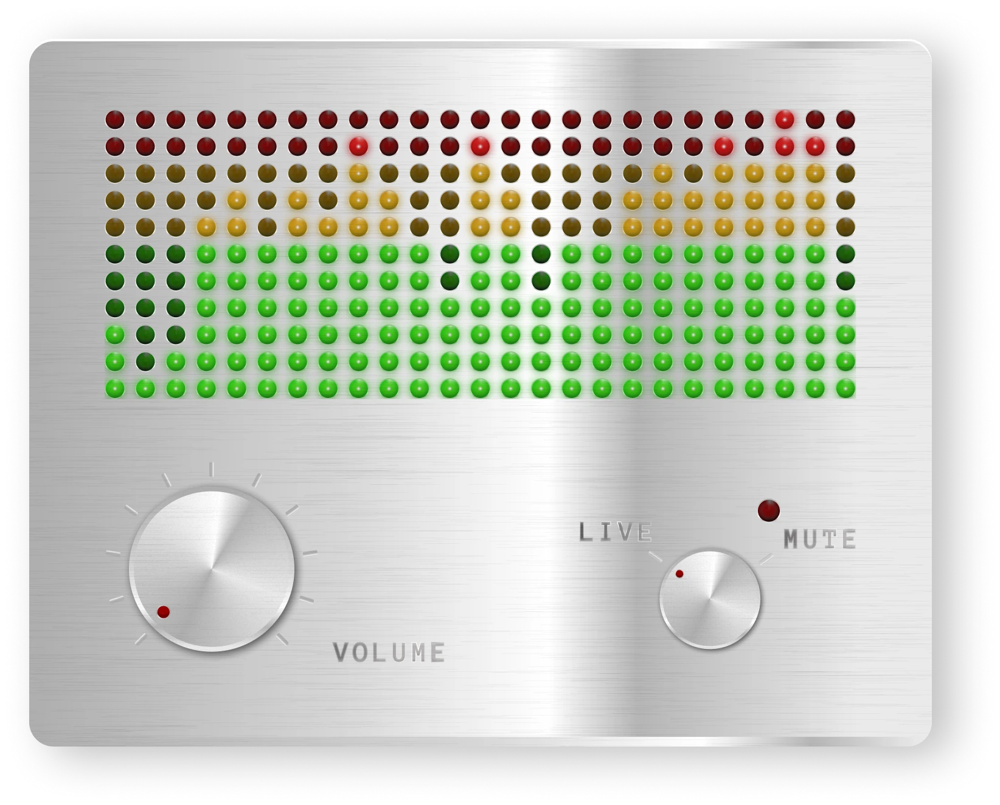
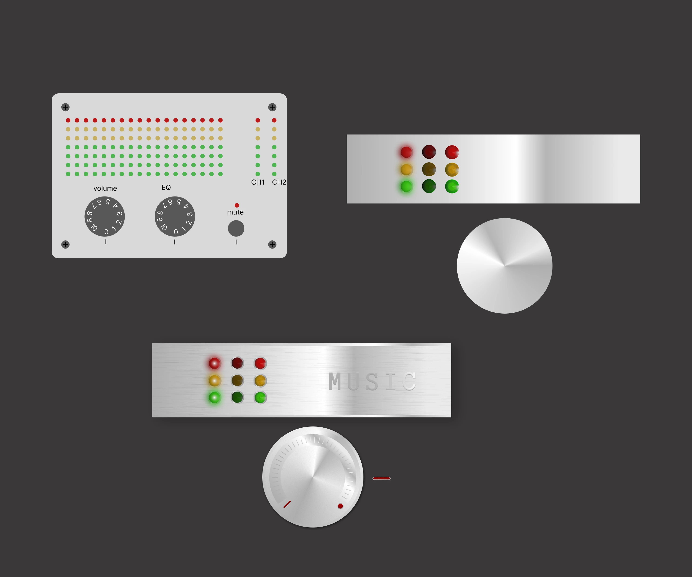
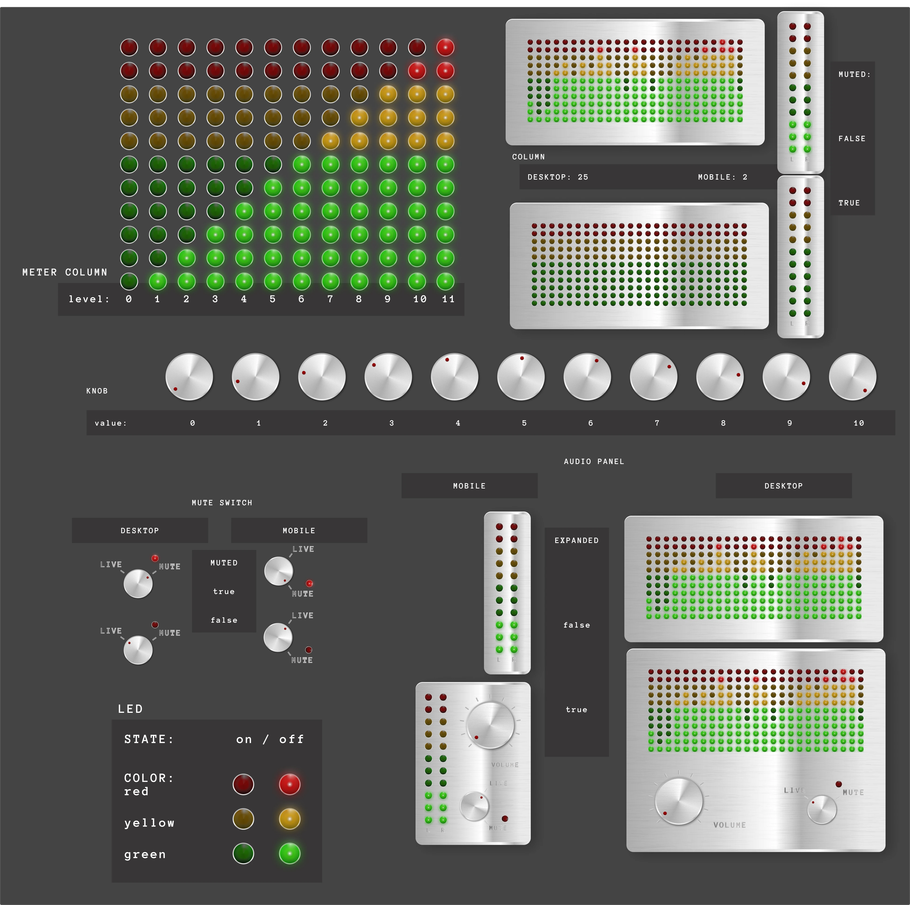
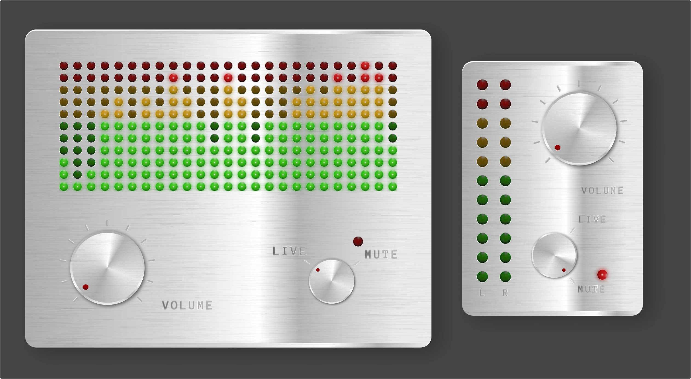

<div align="center">



# AUDIO PANEL

**Un controllo audio in stile hardware vintage per un sito 3D: progettato in Figma, sviluppato con React e la Web Audio API.**

`UI/UX` · `design system` · `Figma` · `React` · `Web Audio API`

</div>

---

## In sintesi

|               |                                                                            |
| ------------- | -------------------------------------------------------------------------- |
| **Progetto**  | Pannello audio sovrapposto alla scena three.js di questo portfolio         |
| **Ruolo**     | Tutto: UI/UX design, design system, prototipo, handoff, sviluppo front-end |
| **Strumenti** | Figma, React 19 + TypeScript, Redux Toolkit, CSS Modules, Web Audio API    |
| **Tempi**     | 2–4 novembre 2026                                                          |
| **Versioni**  | Desktop (25 bande di frequenza) e mobile (canali L/R)                      |

---

## Il problema

Un sito in 3D ha bisogno di un controllo audio che non rompa l'atmosfera. Un player classico, con una barra e un'icona dell'altoparlante, sembra un elemento estraneo sopra un mondo tridimensionale.

L'obiettivo era un controllo che:

- sembrasse un **oggetto fisico**, credibile come un mixer vero
- mostrasse la musica **viva**, con LED che si accendono a ritmo
- facesse solo tre cose: **volume**, **mute**, **aprirsi e chiudersi**
- non coprisse la scena, soprattutto su telefono
- restasse **accessibile** da tastiera e screen reader

---

## Il processo

Sei iterazioni in Figma, ognuna nata da una revisione critica della precedente.



|  #  | Versione           | Cosa ho cambiato e perché                                            |
| :-: | ------------------ | -------------------------------------------------------------------- |
|  1  | Bozza piatta       | Idea chiara, ma tutto piatto e un tasto mute ambiguo                 |
|  2  | Primo metallo      | Gradiente conico sulla manopola, LED bombati                         |
|  3  | Una sola luce      | Luce unica in alto a sinistra, texture spazzolata, ombre di contatto |
|  4  | Stati dei LED      | Accesi saturi con nucleo e glow, spenti al 15–20%                    |
|  5  | Manopola leggibile | Arco di 270°, un solo indicatore, tacche sul pannello                |
|  6  | Mute come manopola | Selettore rotativo LIVE/MUTE con spia rossa                          |

**Il dettaglio che fa il realismo:** in una manopola vera il riflesso non gira, perché la luce è ferma. Ruota solo il puntino.

---

## Design system

Costruito dal più piccolo al più grande, come in React: prima gli atomi, poi i pezzi composti, infine il pannello.



| Componente     | Proprietà           | Valori                            |
| -------------- | ------------------- | --------------------------------- |
| `led`          | `color`, `state`    | green / yellow / red · on / off   |
| `meter-column` | `level`             | 0–11 (6 verdi, 3 gialli, 2 rossi) |
| `meter`        | colonne             | 25 desktop · 2 mobile             |
| `knob`         | `value`             | 0–10                              |
| `mute-switch`  | `muted`             | true / false                      |
| `audio-panel`  | `expanded`, `muted` | true / false                      |

La spia del mute è lo stesso `led` rosso dello spettro; il selettore è lo stesso `knob` del volume, con due sole posizioni.

---

## Interazioni

Quattro stati, da due sole informazioni: **aperto o chiuso**, **live o muto**.

- **Apertura**: clic sul pannello chiuso. La piastra cresce dall'angolo, lo spettro scivola al suo posto, i comandi compaiono dopo.
- **Chiusura**: clic in qualsiasi punto fuori dal pannello, o Esc.
- **Mute**: il selettore gira su MUTE, la spia si accende e i LED si spengono piano, come un meter vero.
- **Musica**: il sito parte in silenzio. Alzare il volume avvia il giradischi; cliccare il giradischi fa salire il volume da solo al 25%.

---

## Responsive: ripensare, non rimpicciolire

Su mobile le 25 bande diventano **2 colonne**, che cambiano significato: i canali sinistro e destro.



|         | Desktop               | Mobile             |
| ------- | --------------------- | ------------------ |
| Chiuso  | 363 × 173 px          | 59 × 225 px        |
| Aperto  | 363 × 283 px          | 157 × 225 px       |
| Spettro | 25 bande di frequenza | 2 canali L/R       |
| LED     | 8 × 8 px              | 12 × 12 px         |
| Comandi | in basso, affiancati  | a destra, impilati |

---

## Dal design al codice

### Architettura audio

```text
musica (AudioBuffer) → uscita (GainNode: volume² / mute) → destination
                              ├→ AnalyserNode (fft 4096) → 25 bande · desktop
                              └→ stereo (GainNode, 2 canali) → ChannelSplitter
                                      ├→ AnalyserNode L → picco in dB · mobile
                                      └→ AnalyserNode R
```

- **Meter post-fader**: l'analisi sta dopo il volume, quindi i LED seguono volume e mute senza codice in più.
- **Bande**: 25 bande logaritmiche da 50 Hz a 16 kHz, come l'orecchio sente le frequenze. Su mobile, il picco di ogni canale in decibel.
- **Ritmo realistico**: salita in 60 ms, discesa in 140 ms; con il mute la discesa rallenta a 900 ms.

### LED a 60 fps senza ridisegnare React

Un solo ciclo `requestAnimationFrame` scrive una variabile CSS per colonna, e solo quando cambia. È il CSS ad accendere ogni LED:

```css
.led {
  --acceso: clamp(0, var(--livello) - var(--i) + 1, 1); /* 0 o 1 */
}
.led::after {
  background: var(--immagine-accesa); /* LED acceso esportato da Figma */
  opacity: var(--acceso);
}
```

### Le scelte di codice

| Scelta                                      | Perché                                                        |
| ------------------------------------------- | ------------------------------------------------------------- |
| Immagini di Figma per LED, tacche e scritte | Aspetto identico al design; lo stato resta al CSS             |
| `popover="auto"` per aprire e chiudere      | Clic esterno ed Esc li gestisce il browser, senza `useEffect` |
| `@starting-style` e `clip-path`             | La stessa piastra si allarga, senza stirare la texture        |
| Pointer Events + `setPointerCapture`        | Mouse, dito e penna con lo stesso codice                      |
| `useSyncExternalStore` su `matchMedia`      | Desktop o mobile senza `useEffect`                            |

### Accessibilità

| Elemento        | Implementazione                                                                 |
| --------------- | ------------------------------------------------------------------------------- |
| Volume          | `role="slider"`, `aria-valuenow`, `aria-valuetext`; frecce, Home/End, rotellina |
| Mute            | `<button role="switch" aria-checked>`, Spazio e Invio                           |
| Pannello chiuso | `<button aria-expanded>` «Apri controlli audio»                                 |
| Movimento       | con `prefers-reduced-motion` niente animazioni, LED a scatti                    |

---

## Cosa ho imparato

- Il realismo nasce dalla **stratificazione**: gradiente, texture, bordi, ombre. Se manca un livello, l'oggetto sembra disegnato.
- Lo skeuomorfismo è una **pelle**: sotto deve esserci un'interfaccia accessibile.
- Prima di scrivere logica, conviene cercare cosa offre già la **piattaforma**: popover, pointer capture, media query.
- Le misure di un handoff vanno verificate a 1x: un LED da 20 px nell'export era da 8 px nel pannello.

<div align="center">

**Il pannello è in questa stanza, in basso a destra.** Spegni il computer e provalo.

</div>
